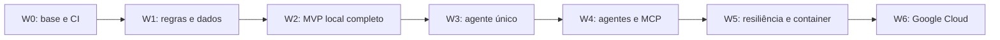

# Plano de implementação por waves

**Revisão funcional e sessões (2026-10-09):** veja [pendências](pendencias.md),
com critérios de conclusão por item. API/MCP agora compartilham catálogo no banco;
histórico e leases de chat são persistidos, com isolamento por cookie, retenção
de quatro turnos, expiração e recuperação após reinício. A atualização não
aprova G4 live, release candidate nem G6 cloud. Os resultados antigos abaixo
permanecem como histórico de execução. Nesta atualização, `make pre-push`
completo passou (129 testes sem navegador, três E2E, 40/40 evals, wheel e smoke
Compose com histórico após reinício), assim como `make postgres-check` e a
comparação offline de três rodadas. Evidências em [pendências](pendencias.md).

**Status:** Mudança de escopo implementada: SQLite serve catálogo e reservas; Compose mantém volume persistente e provider Ollama local opcional (CPU ou override GPU/CUDA), e Gemini via API continua disponível. Husky `.husky/pre-push` e workflow GitHub chamam o mesmo `make pre-push`. Build/smoke Compose, API, documentação e eval offline aprovados. Pendentes: funcionalidades registradas em `pendencias.md`, teste de modelo em GPU e execução remota GitHub. Playwright passou na revisão de 2026-10-09.

**Evidência histórica local W3–W6 parcial:** Na revisão anterior passaram Ruff, formatação, mypy, `make test` (115 testes), `make eval-offline` (40/40) e `make eval-compare` (40/40 casos por arquitetura nas três rodadas; relatório `20261009T040950Z-53dd5e96`). O dataset inclui 20 casos adversariais, com 10 mapeados ao OWASP LLM/Agentic 2026; o runner reproduz o caso multi-turno de contexto. `make build` instalou o wheel fora do checkout; `make compose-check` aprovou fluxo offline, usuário UID 10001, recursos sem escrita, porta e reinício. `make postgres-check` aprovou migration versionada/repetida, startup simultâneo, API, seed, idempotência e disputa da última vaga em PostgreSQL local descartável. Isso não aprova G4 live nem G6 cloud. W3.7 e comparação live aguardam `GOOGLE_API_KEY`, quota suficiente e revisão humana.

Relatórios históricos: comparação pareada [20261009T031731Z-743e0971](../reports/20261009T031731Z-743e0971/summary.md) e métricas agregadas no mesmo diretório; `make build` gerou wheel `d6e7f24bab32d9a9110e167450946b88e9b31a7fadc05aa12bc76ae77b5ac3ff`; smoke Compose registrou digest local `sha256:85b9595c48ca79e1019868b10a67cefcab80578259cd8b1b9173a8c9c4ef9b4e`. Reports são artefatos locais ignorados pelo Git.

**Legenda:** `[x]` concluída com evidência no repositório; `[!] PENDENTE` não concluída ou sem comprovação. Uma task parcialmente feita mantém pendentes seus passos restantes.

Passos ainda sem `[x]` estão sinalizados como `[!] PENDENTE` para orientar a continuação. Nesta rodada foram implementados W4 offline/MCP e passos locais de resiliência e container da W5. A tabela-resumo indica estado geral por wave e não substitui o aceite completo: W4 e W5 dependem da comparação live e demais critérios restantes. Execução remota do CI e proteção de branch seguem pendentes.

Objetivo: entregar EventOps AI localmente com comportamento verificável, depois integrar IA e publicar no Google Cloud. Cada wave termina com uma versão utilizável e evidências. A próxima wave começa após o aceite da anterior.

## Escopo e decisões

| Prioridade | Incluído | Limite |
|---|---|---|
| P0: produto local | Agenda, FAQ com fontes, confirmação, SQLite para catálogo e reservas, Docker Compose, provider offline ou Ollama local opcional | Catálogo de 20 sessões, oito documentos, identidade fictícia |
| P0: engenharia | Lint, tipos, testes, build de imagem, CI e relatórios desde as primeiras waves; gates iguais no pre-push e GitHub Actions | Sem CUDA necessária para testar lógica ou executar modo offline |
| P1: IA e palestra | Agente único ADK/Gemini, coordenador, dois especialistas, MCP local, comparação e falhas controladas | Sem permissões de escrita para especialistas; três delegações no máximo |
| Entrega final | Container, Cloud Run, persistência externa, segredos e smoke cloud | Um serviço de aplicação; dados sempre fictícios |
| Bônus | A2A em segundo processo | Após todos os gates da entrega principal |

React, banco vetorial, Kubernetes, login de pessoas reais, reservas reais, pagamentos e integrações com calendários ficam fora desta entrega.

Decisões atualizadas: Python 3.11, FastAPI, HTML/CSS/JavaScript, SQLite para catálogo e runtime, Docker Compose, Ruff, mypy, pytest com pytest-cov, PyPA build e imagem local Ollama. GPU NVIDIA/CUDA é uma aceleração opcional do serviço local; modo CPU e modo offline continuam disponíveis. Provider API Gemini continua selecionável e é o destino da execução publicada; Ollama não vai para Cloud Run.

Modo offline e quality gates não dependem de GPU nem chamam APIs externas. `make pre-push` e GitHub Actions executam o mesmo gate determinístico; a instalação do hook é explícita. Compose suporta serviço local de modelo opt-in e serviço SQLite persistente. Chamadas Gemini são opcionais, via API, e têm custo.

## Sequência



O detalhamento abaixo contém **46 tasks e 184 passos de atividade**. W0, regras de domínio, API/UI offline, gate de navegador da W2 e implementação de W3.1–W3.6 estão disponíveis. Baseline live W3.7, reprodução do guia em ambiente limpo e etapas remotas de W4–W6 continuam pendentes. W6 tem adapter PostgreSQL, migration versionada e runbook local preparados; nenhum projeto cloud foi provisionado. Os caminhos de arquivos são propostas; ajustar durante a implementação quando houver motivo concreto, preservando contratos e critérios de aceite.

Dependências são explícitas por task. Atividades independentes dentro de uma wave podem ser feitas em qualquer ordem. Integrar mudanças pequenas: cada task deve ter um resultado observável e a validação que o comprova.

## W0 — Base reproduzível e primeiros gates

**Resultado:** projeto mínimo instalável, API de saúde e pipeline que reprova alterações inválidas.

| Task | Implementação e saída | Depende de | Aceite |
|---|---|---|---|
| W0.1 | Criar `pyproject.toml`, pacote `app`, extras de desenvolvimento e dependências resolvidas | — | Instalação em ambiente virtual limpo; versões registradas |
| W0.2 | Configuração tipada, `.env.example`, `.gitignore` e diretórios de runtime | W0.1 | Sem segredos no Git; modo offline padrão; configuração inválida gera erro claro |
| W0.3 | FastAPI com `/health` e teste HTTP básico | W0.1–2 | HTTP 200 em processo local; nenhum acesso ao modelo |
| W0.4 | Ruff, mypy, pytest e build configurados; comandos no Makefile | W0.3 | `make check` e `make build` aprovados |
| W0.5 | GitHub Actions executando os comandos locais e salvando relatórios | W0.4, W0.6 | Sem credenciais Gemini/cloud; checks obrigatórios definidos para PRs |
| W0.6 | Smoke do wheel instalado em ambiente limpo, fora do checkout | W0.4 | Importação e `/health` funcionam sem depender de instalação editável |


### Atividades detalhadas da W0

#### W0.1 — Projeto e dependências

**Arquivos previstos:** `pyproject.toml`, `app/__init__.py`, arquivos de dependências resolvidas e `.python-version`.

- [x] Definir nome, versão inicial, Python de referência e backend de empacotamento. Usar setuptools inicialmente.
- [x] Separar dependências de execução das de desenvolvimento; adicionar FastAPI/Uvicorn ao runtime e Ruff, mypy, pytest, pytest-cov, HTTPX e build ao desenvolvimento.
- [x] Gerar resoluções versionadas para runtime e desenvolvimento com pip-tools; registrar Python e plataforma usados. ADK e ferramentas do navegador entram em suas waves.
- [x] Instalar em uma `.venv` vazia e executar `pip check`; documentar como regenerar a resolução sem atualizar tudo durante cada instalação.

**Evidência:** lista de versões e instalação limpa. Falha de resolução impede continuar para W0.2–3.

#### W0.2 — Configuração e runtime

**Arquivos previstos:** `app/config.py`, `.env.example`, `.gitignore`, `tests/unit/test_config.py`.

- [x] Definir configuração tipada: modo offline por padrão, caminho de banco/logs, host/porta e nível de log. Reservar configurações Gemini para W3.
- [x] Validar modos, porta e diretório gravável; criar apenas o diretório de runtime necessário, sem modificar os recursos empacotados.
- [x] Ignorar `.venv`, `.env`, bancos SQLite e arquivos auxiliares, logs, caches, `dist` e `reports`.
- [x] Cobrir configuração padrão, variável inválida e ausência de chave no modo offline. Ler `.env` apenas por mecanismo documentado.

**Evidência:** teste comprova que um ambiente sem credenciais inicia offline e que configurações inválidas falham de forma clara.

#### W0.3 — Aplicação mínima

**Arquivos previstos:** `app/main.py`, `tests/integration/test_health.py`.

- [x] Criar factory `create_app` para injetar configuração e construir instâncias isoladas nos testes.
- [x] Expor `/health` com estado básico e modo de execução; não retornar segredos, configuração completa ou credenciais.
- [x] Implementar startup/shutdown sem iniciar processos ou conexões de modelo no modo offline.
- [x] Validar com cliente HTTP e com processo real iniciado em porta temporária; encerrar o processo mesmo em falha.

**Evidência:** resposta 200 de um servidor local e teste de lifecycle sem recursos pendurados.

#### W0.4 — Comandos e verificações

**Arquivos previstos:** `Makefile`, configuração em `pyproject.toml`, `tests/conftest.py`.

- [x] Configurar Ruff para erros comuns, imports e formatação; mypy para código próprio tipado, com exceções pontuais para terceiros.
- [x] Configurar pytest, isolamento de diretórios temporários e markers de integração/live. Live não roda por padrão.
- [x] Criar `setup`, `run`, `lint`, `typecheck`, `test`, `build` e `check`; propagar códigos de erro e não esconder falhas de subcomandos.
- [x] Demonstrar, em alteração temporária, que erro de lint, erro de tipo e teste falhando tornam `make check` reprovado; restaurar o código válido.

**Evidência:** resumo dos comandos aprovados e da verificação do comportamento de reprovação. `make build` recebe o smoke completo da W0.6 antes do aceite da wave.

#### W0.5 — CI, pre-push e relatórios

**Arquivos previstos:** `.github/workflows/ci.yml`, documentação de checks obrigatórios.

- [x] Configurar instalação reproduzível e `make pre-push` em pushes e PRs, sem credenciais de modelo ou cloud; workflow configurado (execução remota ainda sem evidência).
- [x] Salvar relatórios e artefatos mesmo quando um comando falhar; manter a conclusão do job reprovada.
- [x] Definir nomes estáveis de checks, retenção inicial de 14 dias e permissões mínimas do workflow.
- [x] Versionar hook Husky `.husky/pre-push` para executar os mesmos quality gates localmente.
- [!] PENDENTE — Quando houver remoto, configurar proteção da branch e comprovar que PR com check reprovado não pode ser integrado; sem remoto, registrar essa configuração como pendente.

**Evidência:** workflow validado e, quando possível, execução CI. A aprovação local não será descrita como CI executado.

#### W0.6 — Build e instalação independente

**Arquivos previstos:** `scripts/check_build.py`, `tests/packaging/` ou smoke equivalente.

- [x] Gerar sdist e wheel a partir da mesma versão de fontes; registrar seus hashes.
- [x] Criar outro ambiente temporário, instalar wheel e dependências resolvidas e executar `pip check`.
- [x] Trocar o diretório de execução para fora do checkout, importar o pacote e iniciar `/health`.
- [x] Detectar importações acidentais da pasta de desenvolvimento; limpar ambiente e processos ao terminar.

**Evidência:** `build.json` com hashes dos artefatos e recursos, exclusão de runtime/segredos e smoke aprovado.

**Gate de saída:** G0 e G1 da [política de qualidade](quality-gates.md). A proteção da branch deve ser configurada quando houver repositório remoto e permissões; workflow sozinho não bloqueia merges.

## W1 — Dados e regras determinísticas

**Resultado:** serviços de agenda, FAQ e reserva funcionam por testes locais, antes da interface.

| Task | Implementação e saída | Depende de | Aceite |
|---|---|---|---|
| W1.1 | 20 sessões e oito FAQs, IDs estáveis, horários com fuso e metadados de fontes | W0 | IDs únicos, capacidade positiva, início anterior ao fim e fontes válidas |
| W1.2 | Filtros de agenda, seleção determinística e detector de conflitos | W1.1 | Intervalos tratados como `[início, fim)`; horários adjacentes permitidos; até três sessões, sem inventar opções |
| W1.3 | Chunking por seção, normalização lexical, ranking e limiar de evidência | W1.1 | Trecho retorna arquivo/seção; pergunta sem evidência recebe abstenção; desempate estável |
| W1.4 | Schema SQLite, inicialização versionada, conexão por operação e transações | W0 | Banco temporário isolado por teste; migração repetível; constraints de unicidade |
| W1.5 | Identidade fictícia do servidor, preview e confirmação expiráveis | W1.4 | Token associado a usuário e sessão; tempo controlável nos testes; token inválido/expirado não grava |
| W1.6 | Reserva transacional e idempotência com fingerprint da solicitação | W1.2, W1.5 | Reserva, consumo de confirmação e resultado idempotente gravados atomicamente |
| W1.7 | Casos de resultado esperados e invariantes de segurança | W1.2–6 | Todos os cenários críticos abaixo automatizados; primeiros casos do dataset versionados |

Casos obrigatórios: ID desconhecido, filtro sem resultados, menos de três sessões, sobreposição parcial/total, horário adjacente, falta de fonte, capacidade esgotada, token de outro usuário/sessão e token expirado.

Reservas: repetir a mesma chave retorna o comprovante original mesmo após consumir o token; a mesma chave com outra intenção retorna conflito. Chaves diferentes para usuário/sessão já reservados não criam nova vaga. Duas conexões independentes disputando a última vaga geram exatamente uma reserva. O teste deve coordenar as tentativas com barreira, conferir o banco e evitar dependência de sleeps.


### Atividades detalhadas da W1

#### W1.1 — Catálogo e documentos

**Arquivos previstos:** `app/data/sessions.json` como seed, `app/data/faq/*.md`, `app/storage.py`, `app/schemas.py`, `tests/unit/test_data.py`.

- [x] Criar 20 sessões fictícias em trilhas/níveis definidos, com conflitos intencionais, sessões adjacentes e horários antes/depois das 14h.
- [x] Usar IDs estáveis e datetimes completos com fuso; definir data e timezone do evento como parte do catálogo.
- [x] Criar oito FAQs: inscrição, reservas, horários, trilhas, acessibilidade, alimentação, conduta e cancelamento. Usar cabeçalhos identificáveis e metadados de versão/data.
- [x] Validar contagem, unicidade, enums, duração e capacidade. Manter documentos maliciosos em fixtures adversariais separadas do catálogo normal.

**Evidência:** seed validado e conteúdo de agenda servido a partir das tabelas SQLite; FAQ Markdown continua empacotado como documentos versionados.

#### W1.2 — Seleção de agenda

**Arquivos previstos:** `app/schedule.py`, `tests/unit/test_schedule.py`.

- [x] Separar filtragem, verificação de conflitos e escolha de sessões; não acessar banco nem modelo nessa lógica.
- [x] Definir que horário mínimo aceita sessões com início maior ou igual ao limite, interpretado no fuso do evento.
- [x] Para o catálogo pequeno, enumerar combinações de até três sessões e escolher primeiro a maior quantidade válida; desempatar por horários de início e IDs. Não usar escolha gulosa que possa perder uma combinação de três.
- [x] Retornar sessões em ordem cronológica e motivo de quantidade reduzida; validar intervalos como `[início, fim)`.

**Evidência:** exemplos com resultado fixo, conflitos parcial/total, igualdade de horário, ausência de opções e escolha de três quando existir combinação válida.

#### W1.3 — Recuperação do FAQ

**Arquivos previstos:** `app/faq.py`, `tests/unit/test_faq.py`.

- [x] Separar Markdown por cabeçalhos e criar chunks com documento, seção, versão/data e texto original.
- [x] Normalizar tokens para busca, mantendo o texto original para exibição. Definir stopwords e ranking lexical simples e explícito.
- [x] Retornar até três trechos; desempatar por ID de documento/seção. Calibrar o limiar com exemplos de desenvolvimento separados dos casos finais de avaliação.
- [x] Responder offline com trechos citados, sem gerar afirmações novas; pergunta sem correspondência útil recebe mensagem de ausência de evidência.

**Evidência:** pergunta conhecida cita trecho correto; pergunta alheia ao evento não retorna regra inventada. Versionar a configuração do ranking/limiar.

#### W1.4 — Banco e transações

**Arquivos previstos:** `app/storage.py` (schema/migration versionados), `tests/unit/test_storage.py`.

- [x] Definir tabelas para schema, sessões/capacidade, confirmações, reservas e idempotência. Manter catálogo e capacidade importados com versão/hash de origem.
- [x] Criar constraints para IDs e unicidade usuário/sessão e usuário/chave idempotente; ativar foreign keys por conexão.
- [x] Abrir conexão por operação, parametrizar SQL e definir timeout finito para locks. Reservas usam transação de escrita explícita, incluindo disponibilidade.
- [x] Inicializar/migrar somente quando necessário; rejeitar catálogo incompatível em vez de alterar capacidades silenciosamente com reservas existentes.

**Evidência:** inicialização repetida preserva dados; rollback desfaz todas as gravações; duas conexões observam um estado consistente.

#### W1.5 — Preview e confirmação

**Arquivos previstos:** `app/reservations.py`, testes de confirmação e fixture de relógio.

- [x] Receber identidade apenas do contexto confiável; na W1, testes fornecem esse contexto e a W2 o conecta à sessão do navegador.
- [x] Validar sessão e gerar preview com título, horário, validade e token aleatório imprevisível; adotar validade inicial configurável de cinco minutos.
- [x] Armazenar hash do token, usuário, sessão, expiração e estado de consumo. Não registrar token bruto nos logs.
- [x] Usar relógio injetável para testar expiração e consumir confirmação apenas na transação que efetiva a reserva.

**Evidência:** token incorreto, expirado, de outra sessão ou de outro usuário nunca gera reserva; preview não ocupa vaga e a disponibilidade é revalidada na confirmação.

#### W1.6 — Reserva e repetição

**Arquivos previstos:** `app/reservations.py`, `app/storage.py`, testes de idempotência/concorrência.

- [x] Definir a ordem: autenticar contexto, consultar idempotência por usuário/chave, comparar fingerprint e devolver resultado persistido quando corresponder.
- [x] Calcular fingerprint da intenção normalizada (usuário e sessão); token e horário de tentativa não mudam a intenção. Repetição autenticada pode recuperar resultado mesmo após expirar/consumir a confirmação original.
- [x] Para nova operação, validar confirmação, checar unicidade/capacidade, inserir reserva e recibo, consumir token e salvar resultado idempotente na mesma transação.
- [x] Definir conflitos para chave com intenção diferente e usuário/sessão já reservados. Não transformar timeout/lock em sucesso nem ocupar vaga parcialmente.

**Evidência:** uma vaga e um recibo para repetições equivalentes; duas identidades disputando última vaga produzem uma reserva; falha induzida antes do commit não deixa escrita parcial.

#### W1.7 — Casos e invariantes

**Arquivos previstos:** `tests/unit/`, `tests/integration/`, `tests/security/`, `evals/cases.jsonl`.

- [x] Criar matriz de cenários críticos relacionando entrada, estado inicial, resultado esperado e teste responsável.
- [x] Preparar fixtures pequenas com expectativas manuais, além do catálogo da apresentação; não gerar o esperado usando a própria função testada.
- [x] Adicionar disputa por capacidade com duas conexões e barreira antes de iniciar a operação, sem colocar barreira dentro da transação bloqueada.
- [x] Exportar resultados/cobertura e criar primeiros casos de agenda, FAQ e reserva no dataset versionado que será completado na W3.

**Evidência:** cada invariante aponta para um teste aprovado; branches dos módulos de domínio atingem o limiar definido em G2.

**Gate de saída:** G0, G1 e G2. Cobertura é um indicador complementar; os cenários críticos têm aprovação obrigatória.

## W2 — MVP local com API e interface

**Resultado:** usuário completa agenda → FAQ → preview → confirmação → comprovante pelo navegador, sem API externa.

| Task | Implementação e saída | Depende de | Aceite |
|---|---|---|---|
| W2.1 | Schemas e endpoints definidos no README; erros consistentes | W1 | Validação HTTP, status e mensagens documentados; campos de identidade não concedem acesso |
| W2.2 | Identidade de demonstração por sessão do navegador e proteção do fluxo de confirmação | W2.1 | Usuários fictícios isolados; confirmação vinculada ao contexto; origens permitidas configuradas |
| W2.3 | HTML/CSS/JS com filtros, fontes, confirmação e comprovante | W2.1–2 | Modo offline visível; estados de carregamento/erro; botão duplicado não cria reservas extras |
| W2.4 | Renderizar conteúdo como texto e validar citações no backend | W2.3 | Documentos e saídas não executam HTML/scripts; fonte inexistente não é exibida como válida |
| W2.5 | Testes de integração API, fluxo de navegador automatizado e lint do JavaScript | W2.3–4 | Fluxo completo, clique repetido e erro de capacidade; teclado permite confirmar/cancelar; ESLint aprovado |
| W2.6 | Empacotar página e FAQs; inicializar catálogo-seed no SQLite | W2.3 | Wheel fora do checkout inicializa e entrega dados/fonte; banco separado e gravável |
| W2.7 | Guia local com setup, run, reset de dados fictícios e troubleshooting | W2.6 | Comandos reproduzidos em ambiente limpo; reset explicitamente limitado à demo local |


### Atividades detalhadas da W2

#### W2.1 — Contratos HTTP

**Arquivos previstos:** `app/main.py`, `app/schemas.py`, `tests/integration/test_api.py`.

- [x] Implementar listagem, sugestão, FAQ, preview e confirmação com schemas explícitos e limites de tamanho de entrada.
- [x] Mapear validação para 422, ausência de identidade para 401, recurso desconhecido para 404 e conflito de capacidade/idempotência para 409; documentar a política de tokens inválidos/expirados.
- [x] Padronizar erro com código, mensagem e ID da solicitação; não expor SQL, tokens ou stack traces ao usuário.
- [x] Exportar OpenAPI e testar exemplos válidos, payload inválido e campos inesperados, incluindo tentativa de fornecer `user_id`.

**Evidência:** contratos HTTP e erros testados; todos os endpoints reutilizam as regras da W1.

#### W2.2 — Sessão fictícia e confirmação no navegador

**Arquivos previstos:** `app/security.py`, integração de sessão e `tests/security/test_demo_session.py`.

- [x] Criar identidade fictícia por sessão com token opaco; persistir sua associação no SQLite. O cookie identifica a sessão, não aceita identidade escolhida pelo cliente.
- [x] Configurar cookie HttpOnly, SameSite e expiração; usar Secure quando houver HTTPS. Definir origens permitidas para operações mutáveis e validar a origem do navegador.
- [x] Vincular preview/reserva à identidade resolvida; chamadas do chat não alteram o estado de confirmação.
- [x] Testar dois contextos de navegador independentes, token de sessão inválido e tentativa de reutilizar confirmação de outro usuário.

**Evidência:** isolamento de identidades e checagem de origem. Identidades, histórico limitado e leases agora são compartilhados via banco; comportamento cloud ainda depende de G6.

#### W2.3 — Página da demonstração

**Arquivos previstos:** `app/static/index.html`, `styles.css`, `app.js`.

- [x] Criar filtros de agenda, cards com IDs/horários e formulário de FAQ com referências visíveis.
- [x] Criar preview separado da efetivação, com confirmar/cancelar; mostrar comprovante somente após sucesso do backend.
- [x] Gerar uma chave idempotente por tentativa de reserva e reutilizá-la no retry de transporte; não gerar outra chave no segundo clique.
- [x] Mostrar carregamento, indisponibilidade, falta de resultados e erro de capacidade; manter navegação por teclado, labels e foco previsível.

**Evidência:** fluxo offline completo e comportamento consistente ao cancelar, repetir clique ou perder a resposta HTTP.

#### W2.4 — Fontes e conteúdo não confiável

**Arquivos previstos:** validação em `app/faq.py`, renderização em `app/static/app.js`, fixtures maliciosas.

- [x] Usar APIs de DOM que renderizam texto para conteúdo de usuário, documento e modelo.
- [x] Conferir referências no índice conhecido; não permitir que IDs de documento se tornem caminhos arbitrários de filesystem.
- [x] Testar texto com tags/script, link externo enganoso e referência a arquivo/seção inexistente.
- [x] Manter mensagem de fonte ausente e impedir que uma citação inválida apareça como verificada.

**Evidência:** conteúdo malicioso permanece texto; nenhum arquivo fora do catálogo é lido ou exibido.

#### W2.5 — Integração, navegador e lint JS

**Arquivos previstos:** `tests/e2e/`, `package.json`, `package-lock.json`, `eslint.config.js` e ajustes no CI.

- [x] Adicionar Playwright Python e instalação de navegador documentada; fixar Node e ESLint como ferramentas de desenvolvimento.
- [x] Automatizar um fluxo completo com catálogo/banco isolados e dois contextos quando houver teste de identidade.
- [x] Repetir clique, simular erro/atraso de transporte e conferir banco/recibo; não validar somente o texto da página.
- [x] Executar ESLint e testes de navegador em `make check`; salvar diagnóstico em falha sem incluir tokens sensíveis.

**Evidência:** JUnit e resultado do navegador aprovados; jobs reprovam erro JavaScript ou fluxo quebrado.

#### W2.6 — Recursos no pacote e catálogo SQLite

**Arquivos previstos:** configuração de package data, leitura de recursos e `scripts/check_build.py`.

- [x] Incluir `app/static`, seed inicial e FAQs no sdist/wheel; carregar recursos empacotados, sem depender do diretório atual.
- [x] Usar tabelas SQLite como fonte de verdade para consultas de agenda; carregar o seed apenas na inicialização configurada.
- [x] Instalar o wheel em ambiente limpo e validar página, JS, catálogo, FAQ e criação de banco externo ao pacote.
- [x] Executar em outro diretório e testar recursos inexistentes com erro explícito.
- [x] Registrar hashes dos artefatos e dos dados; verificar que banco, `.env`, logs e relatórios não foram empacotados.

**Evidência:** aplicação instalada oferece o mesmo MVP do checkout, sem precisar copiar arquivos manualmente.

#### W2.7 — Guia de operação local

**Arquivos previstos:** README e `docs/operacao-local.md`, script de reset local.

- [x] Documentar pré-requisitos, setup, run, URL, checks e localização de dados/relatórios.
- [x] Definir reset explícito para runtime sintético, impedindo execução em modo cloud e caminhos não pertencentes à demo.
- [x] Documentar porta ocupada, caminho sem permissão, dependência/navegador ausente e banco incompatível com catálogo.
- [x] Reproduzir os passos de instalação e execução em virtualenv temporário com banco SQLite isolado; registrar comandos e resultados abaixo.

**Reprodução limpa (2026-10-08):** usando Python 3.11.16, foi criado `/tmp/eventops-wave2-clean-venv`; `python -m pip install --require-hashes -r requirements/py311-dev-agent.txt`, `python -m pip install --no-deps .` e `python -m pip check` concluíram sem conflitos. A aplicação foi iniciada com `EVENTOPS_DATABASE=/tmp/eventops-wave2-clean-runtime/eventops.sqlite3 python -m uvicorn app.main:app --host 127.0.0.1 --port 18765`, fora do checkout. As chamadas a `/health`, `/api/sessions`, `/api/faq` (pergunta sobre acessibilidade) e `/openapi.json` retornaram HTTP 200; health indicou modo offline, a agenda retornou 20 sessões e o FAQ retornou duas fontes válidas. O servidor encerrou normalmente. Esta reprodução valida instalação e fluxo básico da API; o teste E2E de navegador continua coberto pelo gate Playwright descrito acima.

**Evidência:** outra instalação completa o fluxo offline seguindo apenas o guia.

**Gate de saída:** G0–G3. `make check` incorpora integração e fluxo de navegador. Evidência: lint, tipos, 79 testes sem navegador, build wheel/sdist, avaliação offline e smoke Compose passaram; a execução histórica de Playwright ficou bloqueada por `libnspr4.so`, mas a revisão de 2026-10-09 aprovou os três testes de navegador. O CI usa instalação do Chromium com dependências de sistema.

## W3 — Agente único e baseline de qualidade

**Resultado:** IA usa as funções validadas, entrega fontes e encaminha a confirmação; qualidade real medida com protocolo fixo.

| Task | Implementação e saída | Depende de | Aceite |
|---|---|---|---|
| W3.1 | Integração ADK/Gemini configurável e provider falso para testes | W2 | Modo offline não exige chave; testes usam provider falso; falhas não aparecem como sucesso |
| W3.2 | Contratos de tools, allowlist e validação de entradas/saídas | W3.1 | IDs e fontes inválidos rejeitados; agente não possui ferramenta para efetivar reserva |
| W3.3 | `/api/chat` e proposta de reserva conectada ao preview do backend | W3.2 | Somente confirmação explícita pela UI grava; mensagens/documentos não confirmam operações |
| W3.4 | Traces com versões, chamadas, duração, tokens e estado do resultado | W3.3 | Sem chaves/tokens de confirmação nos logs; consumo ausente marcado como desconhecido |
| W3.5 | Completar dataset de 20 casos normais e 20 adversariais | W1.7, W3.2 | Oráculos, ferramentas permitidas, fontes e ações proibidas definidos por caso |
| W3.6 | Runner de evals offline, replay e live, produzindo JSON e Markdown | W3.4–5 | Avaliadores independentes da implementação; timeout conta como falha; modos identificados |
| W3.7 | Baseline SINGLE_AGENT com três rodadas completas | W3.6 | G4 aprovado; relatório registra todas as tentativas e falhas, sem selecionar respostas favoráveis |

Separar saída bruta do modelo, resultado validado e fallback. A validação pode impedir um erro de chegar à UI; o erro bruto continua registrado na avaliação do agente.


### Atividades detalhadas da W3

#### W3.1 — Integração com o modelo

**Arquivos previstos:** `app/agent.py`, configuração, dependências e `tests/fixtures/fake_model.py`.

- [x] Fixar `google-adk==2.11.0`; o modelo é configurável por `EVENTOPS_AGENT_MODEL`, com temperatura 0.1 e limite de 700 tokens de saída.
- [x] Construir o caminho live somente quando configurado, validando chave/modelo sem expor os valores secretos.
- [x] Criar provider falso com cenários de resposta, tool call, erro e timeout; manter modo offline independente de credenciais.
- [x] Aplicar timeout de solicitação ao ADK/Ollama e limite de três chamadas de ferramenta por solicitação; retries automáticos de SDK não são habilitados pela aplicação.

**Evidência:** comportamento contratual aprovado com provider falso e primeira chamada live identificada, sem declarar baseline antes da W3.7.

#### W3.2 — Ferramentas e saída estruturada

**Arquivos previstos:** `app/tools.py`, schemas e testes de tools.

- [x] Expor consulta de sessões, verificação de conflitos e busca de políticas, reutilizando funções da W1.
- [x] Definir saída estruturada para IDs, fontes e proposta de reserva; validar também os dados retornados pelo modelo.
- [x] Restringir ferramentas permitidas e tamanho dos resultados; não expor conexão de banco ou função de efetivação ao agente.
- [x] Testar ID inventado, conflito, campo/schema extra, allowlist sem tool de escrita e fixture de prompt injection fora do catálogo publicado.

**Evidência:** tool inválida é bloqueada e registrada; resultado bruto inválido não se transforma em sucesso do agente.

#### W3.3 — Conversa e proposta de ação

**Arquivos previstos:** `/api/chat`, schema de resposta e seção de chat na página.

- [x] Conectar conversa a agenda/FAQ; histórico curto é particionado por cookie de sessão opaco e mantém no máximo quatro turnos (oito mensagens).
- [x] Transformar proposta válida de reserva em opção para abrir preview; o modelo não cria confirmação nem executa o clique.
- [x] Exibir resposta, fontes e erro/fallback explícitos, preservando filtros offline disponíveis.
- [x] Cobrir proposta sem gravação, fixture maliciosa isolada, isolamento de cookies e recusa de confirmação sem token no dataset e testes.

**Evidência:** conversa pode sugerir sessão, mas somente o fluxo autenticado de preview/confirmar grava uma reserva.

#### W3.4 — Traces e métricas

**Arquivos previstos:** `app/metrics.py`, logger estruturado e testes de redaction.

- [x] Definir ID de solicitação, modo, versões, chamada, ferramenta, duração e status; correlacionar chamadas com a tarefa.
- [x] Capturar tokens reportados pelo provider, incluindo tentativas falhas quando houver consumo disponível.
- [x] Redigir chaves/tokens estruturados e em texto; logs omitem a saída bruta e respostas preservadas em traces HTTP são do dataset sintético. Histórico limitado de conversa e leases ficam no banco por hash da sessão de navegador, com expiração.
- [x] Registrar separadamente saída bruta, validação e fallback; deixar métricas ausentes como desconhecidas.

**Evidência:** trace reconstrói uma tarefa sem revelar segredo e sem atribuir token zero a consumo não informado.

#### W3.5 — Dataset completo

**Arquivos previstos:** `evals/cases.jsonl`, `evals/fixtures/`, schema de caso e documentação do dataset.

- [x] Completar a distribuição atual de 20 casos normais e 20 adversariais definida em G4; cada ID deve ser único e estável.
- [x] Registrar estado inicial, pergunta, fatos/fontes esperados, tools permitidas, ações proibidas e efeitos esperados nos 40 casos, incluindo riscos OWASP LLM/Agentic e uma sequência multi-turno de contexto.
- [x] Definir roteiro explícito UI/API para propostas, preview/cancelamento e tentativas sem confirmação; a resposta do modelo nunca equivale a confirmação.
- [x] Manter fixture adversarial fora do catálogo FAQ e validar existência de fixtures e fontes no carregamento do dataset.

**Evidência:** dataset validado estruturalmente, com revisão das expectativas antes da execução live.

#### W3.6 — Runner e avaliadores

**Arquivos previstos:** `scripts/run_evals.py`, `evals/evaluators.py`, fixtures de replay e testes de avaliação.

- [x] Implementar modos offline/replay/live e isolamento de banco, sessão e histórico por caso.
- [x] Avaliar estruturalmente IDs, conflitos, fontes, trajetória, allowlist e efeitos sem confiar na decisão do agente. Alegações livres ainda exigem revisão humana registrada no baseline live.
- [x] Aplicar orçamento/deadline e salvar toda tentativa; interrupção produz relatório parcial e exit code de reprovação.
- [x] Gerar manifesto, resultados por caso/rodada e summary; testar o avaliador contra respostas deliberadamente erradas.

**Evidência:** runner reprova fixtures com falhas conhecidas e não depende do próprio agente para decidir sua aprovação.

#### W3.7 — Baseline live

**Arquivos previstos:** relatórios de execução e `evals/baselines/single-agent.json` sanitizado.

- [!] PENDENTE — Preflight local confirmou que falta `GOOGLE_API_KEY`; quando configurada, validar quota e congelar dataset, parâmetros, prompts e versão avaliada.
- [!] PENDENTE — Executar as três rodadas completas sem selecionar respostas; preservar timeout e falhas no denominador. Não iniciado: o preflight encerrou sem chamadas devido à ausência de `GOOGLE_API_KEY`.
- [!] PENDENTE — Revisar alegações que não possuem avaliador determinístico e registrar decisão/fatos sustentadores.
- [!] PENDENTE — Aprovar somente pelos limiares de G4; salvar baseline com hashes e limitações. Em falha, corrigir e executar novo protocolo completo preservando o anterior.

**Evidência:** 120 execuções por arquitetura previstas no protocolo, relatórios completos e gate aprovado por rodada.

**Gate de saída:** G0–G4. Aprovação offline não comprova qualidade do modelo. Sem chave ou quota, W3.7 permanece pendente e a conclusão live não é declarada.

## W4 — Coordenador, especialistas e MCP local

**Resultado:** comparar arquiteturas sobre a mesma tarefa, com protocolo MCP verificável e custo observado.

| Task | Implementação e saída | Depende de | Aceite |
|---|---|---|---|
| W4.1 | Servidor MCP local de agenda, reutilizando as regras da W1 | W3 | Contratos e resultados equivalentes às ferramentas internas |
| W4.2 | Cliente MCP e lifecycle do processo; falhas e cancelamento | W4.1 | Processo encerra com a aplicação/teste; timeout não deixa chamadas penduradas |
| W4.3 | Coordenador, `schedule_agent` e `faq_agent` com permissões restritas | W4.2 | Até três delegações e limite global de chamadas por solicitação |
| W4.4 | Seleção SINGLE_AGENT/MULTI_AGENT e logs comparáveis | W4.3 | Mesmo catálogo, prompts de usuário, modelo, fontes e configurações |
| W4.5 | Suite de contrato MCP por transporte real local | W4.1–4 | Schema inválido rejeitado, erro propagado e resultado serializado corretamente |
| W4.6 | Experimento pareado e relatório por arquitetura | W4.4–5 | G4 aprovado por modo; diferenças de qualidade, chamadas, tokens e duração documentadas |

Multiagent não precisa superar o single agent para a apresentação. Se tiver qualidade inferior aos limites ou ao baseline, permanece experimento e o single agent continua como padrão aprovado. Não declarar economia sem dados de consumo completos e preços versionados.


### Atividades detalhadas da W4

#### W4.1 — Servidor MCP de agenda

**Arquivos previstos:** `mcp_server/server.py`, schemas e dependências fixadas.

- [x] Escolher stdio e documentar `python -m mcp_server.server`.
- [x] Expor listagem e verificação com regras comuns de agenda; entrada tem schema estrito e limites.
- [x] Configurar logs do servidor em stderr; stdout permanece reservado ao protocolo.
- [x] Consultar o banco configurado, compartilhado com a API; usar package resources somente para seed de banco vazio na execução manual. Rejeitar IDs desconhecidos; ler alterações persistidas a cada chamada.

**Evidência:** cliente real descobre tools e recebe os mesmos resultados da consulta interna.

#### W4.2 — Cliente e lifecycle

**Arquivos previstos:** `app/mcp_client.py`, testes de subprocesso e configuração do comando.

- [x] Iniciar processo no lifecycle do cliente e aguardar inicialização de sessão MCP antes das tools.
- [x] Aplicar timeout/cancelamento e propagar falhas explícitas ao coordenador.
- [x] Encerrar transporte/processo no sucesso, cancelamento e falha de inicialização.
- [x] Testar processo ausente, cancelamento de chamada, uso repetido e encerramento via context manager.

**Evidência:** processo real usado no teste termina ao encerrar aplicação/runner.

#### W4.3 — Coordenador e especialistas

**Arquivos previstos:** `app/agents/coordinator.py`, `schedule_agent.py`, `faq_agent.py` e prompts versionados.

- [x] Organizar coordenador e especialistas em `app/agents/`; prompts e versões têm identificadores distintos. Roteamento multi é determinístico offline.
- [x] Restringir agenda a listagem MCP e FAQ a recuperação; nenhuma tool de escrita é exposta.
- [x] Compartilhar orçamento de três delegações e três tools por solicitação.
- [x] Consolidar e validar IDs/fontes; gravações continuam exclusivas do fluxo HTTP confirmado.
- [!] PENDENTE — Configurar providers Gemini/Ollama para coordenador/especialistas; ambos retornam indisponibilidade explícita até configuração.

**Evidência:** roteamento normal e misto aprovado; pedido que excede orçamento termina de forma explícita.

#### W4.4 — Seleção de modo e comparação justa

**Arquivos previstos:** configuração/request de modo, traces e interface.

- [x] Separar provider (`EVENTOPS_AGENT_MODE`) de arquitetura (`architecture=single|multi` no request), com validação explícita.
- [x] Manter single como padrão e mostrar arquitetura/delegações na resposta da interface.
- [x] Registrar modelo, hash do catálogo/fontes, orçamento e versões de prompt no relatório pareado offline.
- [x] Rotular experimento como tools internas no single versus MCP stdio no multi; diferenças incluem transporte.
- [!] PENDENTE — Implementar comparação single/multi ambos via MCP, se for necessário isolar somente a orquestração.

**Evidência:** manifesto permite identificar se diferenças de latência incluem transporte MCP ou apenas arquitetura.

#### W4.5 — Contratos MCP

**Arquivos previstos:** `tests/contracts/test_mcp.py`, fixtures do processo e comparação de resultados.

- [x] Testar descoberta, schemas, chamadas, conteúdo estruturado e erros via stdio real.
- [x] Comparar consulta MCP com resultado esperado diretamente das regras/catálogo.
- [x] Cobrir timeout configurado, cancelamento, payload inválido e processo ausente.
- [x] Executar contratos em `make check` pela coleta padrão do pytest.

**Evidência:** suite aprovada e lifecycle verificado; erro de protocolo reprova o gate.

#### W4.6 — Experimento pareado

**Arquivos previstos:** modo de comparação no runner e relatório por arquitetura.

- [x] Executar casos intercalados em três rodadas offline; cada pergunta começa sem histórico e sem gravações.
- [x] Salvar acertos por categoria/rodada, trajetória, tools, tokens conhecidos, retries (zero no modo offline) e duração; custo ausente permanece desconhecido.
- [x] Preservar resultados por caso e rotular diferença de transporte no resumo e manifesto.
- [!] PENDENTE — Executar protocolo live pareado e revisão humana. Resultado offline não aprova G4 do modelo; single permanece padrão.

**Evidência:** relatório pareado completo; a wave não recebe aceite de ambos os modos enquanto o gate multi estiver reprovado.

**Gate de saída:** G0–G4 nos dois modos; contrato MCP aprovado. A demo de comparação inclui resultados desfavoráveis e limitações.

## W5 — Resiliência, container e release local

**Resultado:** artefato pronto para publicação e narrativa de falhas comprovada localmente.

| Task | Implementação e saída | Depende de | Aceite |
|---|---|---|---|
| W5.1 | Timeouts, retries limitados, backoff/jitter e deadline global | W4 | Somente falhas transitórias elegíveis; duração total limitada; sem retry cego de escrita |
| W5.2 | Circuit breaker didático e fallback explícito | W5.1 | Abrir após três falhas, aguardar 15 s e permitir tentativa controlada; relógio falso nos testes |
| W5.3 | Injeção local de atraso/falha e regressões adversariais | W5.1–2 | Nenhuma reserva não confirmada ou resposta fictícia apresentada como sucesso |
| W5.4 | Dockerfile instalando o artefato, configuração `PORT` e runtime separado | W2.6, W5.3 | Container entrega página e dados; não inclui segredos, banco local ou relatórios de desenvolvimento |
| W5.5 | Smoke HTTP do container e teste de persistência com volume local | W5.4 | Executar fluxo, reiniciar container e conferir reserva/idempotência no volume |
| W5.6 | Relatório de latência/custo e roteiro da apresentação | W3.7, W4.6, W5.5 | Estimativa separada de faturamento; falhas/retries entram no consumo; p95 somente com amostras suficientes |
| W5.7 | Release candidate com manifesto e evidências | W5.6 | G0–G5 aprovados no mesmo commit; documentação local atualizada |

Parâmetros iniciais de laboratório: timeout de ferramenta 3 s, prazo por tarefa 12 s e até duas tentativas adicionais elegíveis, sempre dentro do prazo total. Calibrar com medições e congelar os parâmetros antes da avaliação; registrar a mudança e repetir os casos afetados. Evitar retries sobrepostos no SDK e no backend.


### Atividades detalhadas da W5

#### W5.1 — Deadline e retries

**Arquivos previstos:** `app/resilience.py`, configuração e testes de política.

- [x] Definir deadline compartilhado por agente e tools/delegações, usando o tempo restante.
- [x] Classificar falhas transitórias tipadas; até duas tentativas adicionais de leitura, separadas do orçamento de delegações e registradas no trace.
- [x] Injetar sleep/jitter nos testes. A aplicação não adiciona retry a gravações; retry HTTP existente reutiliza a mesma chave de idempotência.
- [!] PENDENTE — Verificar/configurar retries internos do SDK live para impedir sobreposição com o retry da aplicação; Gemini não executado ainda.

**Evidência:** teste prova limite total, tentativas elegíveis e ausência de duplicação após resposta perdida.

#### W5.2 — Circuit breaker e fallback

**Arquivos previstos:** política por dependência e testes com relógio falso.

- [x] Implementar estados fechado, aberto e tentativa controlada (três falhas, 15 s) com relógio injetável.
- [x] Aplicar ao processo MCP; payload inválido da API é rejeitado antes do breaker.
- [x] Liberar uma tentativa após intervalo; fechar novamente somente com sucesso, reabrir em falha.
- [x] Retornar FAQ parcial verificada quando agenda MCP está indisponível; IDs de sessão ficam vazios e trace marca partial/fallback.
- [!] PENDENTE — Adicionar breaker para provider Gemini/Ollama após teste de falhas reais.

**Evidência:** transições, reabertura e recuperação testadas; circuito por instância identificado como tal no relatório.

#### W5.3 — Falhas controladas

**Arquivos previstos:** `scripts/inject_failure.py`, hooks restritos ao laboratório e testes adversariais.

- [x] Injetar falha permanente/timeout via provider de harness e testar falhas transitórias/retries com relógio e provider controlados.
- [x] Remover marcadores de falha do chat público; hooks só são selecionados pelo runner por ID/categoria do caso.
- [x] Reexecutar casos offline de injection, falha, idempotência e capacidade; verificar erro, trace e contador de gravações.
- [x] Runner salva cada tentativa e trace com status, retry/fallback e gravações observadas/esperadas.
- [!] PENDENTE — Adicionar harness de atraso e encerramento abrupto do processo MCP durante uma chamada.

**Evidência:** nenhuma ação proibida e nenhum efeito duplicado, inclusive após recuperar a dependência.

#### W5.4 — Imagem de aplicação

**Arquivos previstos:** `Dockerfile`, `.dockerignore` e configuração de runtime.

- [x] Construir imagem multi-stage com base Python fixada por digest; smoke Compose registra ID/digest local.
- [x] Verificar UID 10001, bind em `0.0.0.0` e porta de container configurada por `PORT`.
- [x] Smoke confirma que pacote instalado não aceita escrita pelo app user e SQLite externo permanece gravável.
- [x] Excluir chaves, bancos, código de testes e relatórios de desenvolvimento; não exigir Node na imagem.

**Evidência:** Compose offline iniciou; `/health` e catálogo SQLite responderam; reinício manteve as 20 sessões. Smoke executado e removido por `scripts/check_compose.py`.

**Mudança de escopo local:** Compose persiste SQLite no volume `eventops-data`. Ollama é opcional no perfil `local-model` (CPU); CUDA fica em override `compose.gpu.yaml`, com pesos em volume próprio. Modo offline não inicia modelo. Para Cloud Run, usar Gemini via API e storage externo planejado em W6, sem Ollama no container publicado.

#### W5.5 — Smoke e reinício

**Arquivos previstos:** `scripts/check_compose.py` e fixtures de volume temporário.

- [x] Subir imagem em porta temporária com volume novo, aguardar saúde e executar agenda e chat multi/MCP via HTTP.
- [x] Simular repetição da solicitação e conferir recibo/idempotência via HTTP, mantendo cookie de sessão.
- [x] Reiniciar o container usando o mesmo volume e validar sessões, reserva única e repetição do recibo idempotente original.
- [x] Encerrar/remover recursos de teste ao final e registrar digest da imagem no log do smoke.

**Evidência local:** `make compose-check` aprovou health, agenda, multi/MCP, confirmação/idempotência, restart e receipt original, verificando UID 10001 e diretório do pacote sem escrita. Digest local registrado no log de execução; o volume comprova laboratório, não persistência cloud.

#### W5.6 — Métricas e roteiro

**Arquivos previstos:** `scripts/report_metrics.py`, `docs/roteiro-demo.md`, tabela de preços datada.

- [x] Agregar resultados por arquitetura/categoria com n, sucesso, falha, timeout, tools e retries.
- [x] Calcular mediana/extremos e p95 apenas com pelo menos 100 amostras; preservar falhas no denominador.
- [x] Deixar consumo de tokens/custo como desconhecido quando não completo; não criar custo estimado sem preço e uso observados.
- [x] Documentar demos, comandos, estado/reset e exigir que gravação futura seja identificada.
- [!] PENDENTE — Adicionar custos live e infraestrutura com fonte de preço datada após execução live/deploy.

**Evidência:** relatório reproduzível a partir das execuções salvas e roteiro sem números inventados.

#### W5.7 — Release candidate

**Arquivos previstos:** manifesto de release e resumo de gates.

- [!] PENDENTE — Congelar versão de código, resolução, dados, prompts, modelo e configuração; rejeitar fontes modificadas sem novo hash.
- [!] PENDENTE — Executar gates offline completos e conferir que evidência live se refere à configuração/candidato atuais.
- [!] PENDENTE — Identificar wheel/imagem por hash/digest, associando relatórios e pendências não críticas documentadas.
- [!] PENDENTE — Marcar release local pronta somente após G0–G5; qualquer alteração relevante produz novo candidato.

**Evidência:** um manifesto permite reconstruir qual código, imagem e avaliação foram aprovados.

Não emitir aceite W5.7 enquanto W3.7/G4 live, comparação live e falhas de MCP controladas pendentes não tiverem evidência. O smoke de container local, mesmo aprovado, não substitui release candidate completo.

**Gate de saída:** G0–G5. A demo completa local deve sobreviver a indisponibilidade e repetição de clique. Limites de chamadas/tokens são aplicados antes de iniciar nova chamada; ultrapassar limite gera interrupção explícita.

## W6 — Publicação final no Google Cloud

**Resultado:** mesma experiência por URL cloud, com reservas persistentes e configuração operacional documentada.

| Task | Implementação e saída | Depende de | Aceite |
|---|---|---|---|
| W6.1 | Decisão documentada de banco, região, identidade/acesso e custo | W5 | Banco suporta transação atômica e unicidade/idempotência; preços e quotas verificados |
| W6.2 | Adapter externo, migrations e mesma suite de contratos de storage | W6.1 | Repetição e disputa de última vaga corretas em conexões independentes; confirmações persistidas |
| W6.3 | Preparar projeto, Artifact Registry, segredos e identidade do serviço | W6.1 | Configuração reproduzível; permissões restritas às operações usadas |
| W6.4 | Pipeline manual para publicar a imagem aprovada, identificada por digest | W6.2–3 | Nova imagem com adapter externo passa novamente por G0–G5 antes do deploy |
| W6.5 | Smoke cloud, concorrência e persistência após nova instância/revisão | W6.4 | G6 aprovado; reservas/idempotência compartilhadas, inclusive com duas instâncias |
| W6.6 | Runbook de atualização, rollback, orçamento e remoção | W6.5 | Revisão anterior recuperável; migrations compatíveis; recursos e dados sintéticos identificados |

O SQLite local não será usado como persistência de reservas no Cloud Run. O filesystem da instância é temporário. Escolher armazenamento externo na W6.1, antes de habilitar a gravação publicada; não simular persistência perdida como resultado válido.

Cloud Run atende API e página em um serviço. MCP pode permanecer na demo local; registrar no manifesto se a implantação usa tools internas. Se MCP for publicado, repetir os contratos para o transporte/processo incluído. A2A permanece bônus local.

Começar com escala mínima zero e poucas instâncias; medir para ajustar concorrência, timeout e memória. Orçamento alerta consumo, enquanto limites de chamadas/tokens controlam o uso da aplicação. O acesso à demo deve ser definido antes da publicação, pois a identidade local fictícia não representa autenticação de produção.


### Atividades detalhadas da W6

#### W6.1 — Decisões de publicação

**Arquivos previstos:** `docs/decisoes/001-cloud.md` e levantamento de custo/configuração.

- [x] Escolher Cloud SQL for PostgreSQL como candidato por transações relacionais e unicidade; adapter local validado. Firestore não foi adotado porque exigiria remodelar o contrato transacional atual.
- [!] PENDENTE — Confirmar região (candidata: `southamerica-east1`), acesso à demo, limite de instâncias, timeout, concorrência e estratégia de modelo/segredos com o projeto real.
- [!] PENDENTE — Dimensionar recursos, consultar preços/quota na região escolhida e registrar estimativa antes de criar qualquer recurso.
- [x] Definir persistência compartilhada para reservas, capacidades/catálogo, idempotência, confirmações, sessões fictícias, histórico limitado de chat e leases. Schema SQLite v3 e migration PostgreSQL `0002_chat_sessions.sql` adicionam histórico e leases.

Cloud SQL PostgreSQL pode ser conectado ao Cloud Run pelo fluxo oficial da Google; a região precisa ser escolhida ao criar a instância. O preço depende de CPU, memória, armazenamento, rede e região e a instância ativa é cobrada por tempo de execução. Não há estimativa numérica congelada nesta decisão; os preços devem ser consultados antes de provisionar. Fontes: [conectar Cloud Run ao Cloud SQL PostgreSQL](https://docs.cloud.google.com/sql/docs/postgres/connect-run), [disponibilidade regional](https://docs.cloud.google.com/sql/docs/postgres/region-availability-overview) e [preços do Cloud SQL](https://cloud.google.com/sql/pricing).

**Evidência:** decisão candidata e fontes atuais; região, acesso, quota e custo continuam pendentes, sem qualquer provisionamento.

#### W6.2 — Adapter externo e migrações

**Arquivos:** adapter PostgreSQL em `app/postgres_compat.py`, migrations em `app/migrations/` e smoke de contratos em `scripts/check_postgres.py`.

- [x] Adicionar suporte a PostgreSQL no storage existente, preservando operações de domínio e sem uma abstração genérica.
- [x] Implementar schema, índices/constraints, isolamento serializável e conexão via `EVENTOPS_DATABASE_URL`; segredo fica fora do código versionado.
- [x] Validar seed/migration versionada e repetível, API, receipt/idempotência e disputa paralela da última vaga com conexões independentes usando `make postgres-check` e PostgreSQL local descartável.
- [x] Incluir migration SQL no wheel e sdist e preparar runbook candidato com validação, backup, rollback e privilégios.
- [!] PENDENTE — Separar migrations em job de deploy com credencial DDL distinta, testar falha/rollback em ambiente cloud e executar contratos no Cloud SQL real.

**Evidência:** disputa de última vaga, repetição, confirmação e sessão fictícia corretas no banco real de laboratório.

#### W6.3 — Recursos e segredos

**Arquivos previstos:** scripts declarativos em `scripts/cloud/` e inventário de recursos.

- [!] PENDENTE — Habilitar recursos necessários no projeto/região definidos e preparar registry, banco e armazenamento de segredos.
- [!] PENDENTE — Separar identidade de publicação da identidade de execução; conceder somente permissões efetivamente usadas.
- [!] PENDENTE — Referenciar segredos sem gravá-los em imagem, argumentos públicos ou relatórios; documentar rotação.
- [!] PENDENTE — Criar alertas de orçamento, retenção de logs e limites de aplicação; salvar nomes/IDs não secretos para atualização e limpeza.

**Evidência:** inventário reproduzível e aplicação consegue acessar apenas as dependências necessárias.

#### W6.4 — Publicação da imagem aprovada

**Arquivos previstos:** workflow manual ou script documentado de deploy.

- [!] PENDENTE — Após adicionar o adapter externo, gerar novo release candidate e repetir G0–G5; não reutilizar evidência de imagem anterior à mudança.
- [!] PENDENTE — Publicar imagem identificada por digest e aplicar configuração de porta, banco, segredos, acesso e escala.
- [!] PENDENTE — Registrar digest, revisão, região, versões de configuração e schema no manifesto cloud.
- [!] PENDENTE — Manter publicação manual separada dos PRs e evitar segredos/valores sensíveis em saída de comandos.

**Evidência:** revisão publicada corresponde exatamente ao novo candidato validado localmente.

#### W6.5 — Validação cloud

**Arquivos previstos:** `scripts/cloud/smoke.py` e relatório G6.

- [!] PENDENTE — Executar o fluxo por URL cloud com identidade de demonstração válida e dados sintéticos isolados.
- [!] PENDENTE — Testar capacidade e idempotência por conexões independentes e comprovar compartilhamento de sessões/confirmações.
- [!] PENDENTE — Criar nova revisão ou instância e verificar reserva/recibo originais. Para cenário multi-instância, usar configuração temporária e evidência de IDs de instância nos logs, sem supor que requisições concorrentes sempre caem em instâncias diferentes.
- [!] PENDENTE — Validar acesso negado quando esperado e registrar indisponibilidade como falha; devolver escala temporária à configuração final.

**Evidência:** URL, digest/revisão, banco/schema e invariantes aprovados; nenhuma perda de dados entre instâncias.

#### W6.6 — Operação e encerramento

**Arquivos:** `docs/operacao-cloud.md`; os comandos de provisionamento/remoção continuam sem projeto e inventário reais.

- [x] Documentar publicação, validação, rollback de revisão, compatibilidade de schema, configuração, custo e remoção segura.
- [!] PENDENTE — Ensaiar rollback e restauração em projeto de teste; registrar responsáveis, orçamento, alertas, quotas e inventário efetivos.
- [!] PENDENTE — Gerar comandos de remoção vinculados aos IDs reais após provisionamento; escrita não significa executar.

**Evidência:** runbook revisável, rollback ensaiado no laboratório e projeto concluído somente com G0–G6.

**Gate de saída:** G0–G6, com evidências reais de publicação. Nenhum deploy faz parte dos checks padrão de PR.

## Organização das entregas

Para executar cada task:

1. Confirmar dependências concluídas e preparar fixtures/estado inicial necessários.
2. Implementar os itens do checklist mantendo o resultado observável indicado.
3. Executar os cenários específicos e os gates exigidos na wave.
4. Registrar evidências e atualizar documentação/contratos.
5. Marcar a task concluída somente se os critérios estiverem comprovados; registrar o motivo quando permanecer pendente.

Registro mínimo de entrega:

```text
Task: Wn.m
Status: pendente | em execução | concluída
Versão avaliada: commit ou hash das fontes
Resultado observado:
Arquivos alterados:
Comandos e códigos de saída:
Relatórios e hashes dos artefatos:
Critérios comprovados:
Pendências e impacto nas próximas tasks:
```

Não estimar duração como compromisso antes da W0–W2: integração com modelo, avaliação live e banco gerenciado dependem de medições e disponibilidade de serviços. O progresso é acompanhado por tasks aceitas e waves aprovadas.

Uma task pode ser um PR ou um commit revisável; agrupar somente mudanças com o mesmo aceite. Cada entrega registra: IDs de tasks, comportamento observável, arquivos alterados, comandos executados, relatório gerado e pendências.

Atualizar as caixas abaixo apenas com a respectiva evidência:

- [!] PENDENTE — W0 — Base, CI e pacote aprovado.
- [x] W1 — Regras e invariantes locais aprovados (G0–G2 locais comprovados).
- [x] W2 — MVP offline completo aprovado localmente; reprodução em ambiente limpo registrada em W2.7.
- [!] PENDENTE — W3 — Agente único com baseline live aprovado.
- [!] PENDENTE — W4 — MCP e comparação de agentes aprovados.
- [!] PENDENTE — W5 — Container e release local aprovados.
- [!] PENDENTE — W6 — Google Cloud e persistência aprovados.

Se uma wave falhar, corrigir ou reduzir formalmente o escopo e atualizar os critérios antes de continuar. Um teste pulado não equivale a aprovação; uma mudança de limiar exige justificativa versionada e nova avaliação.
